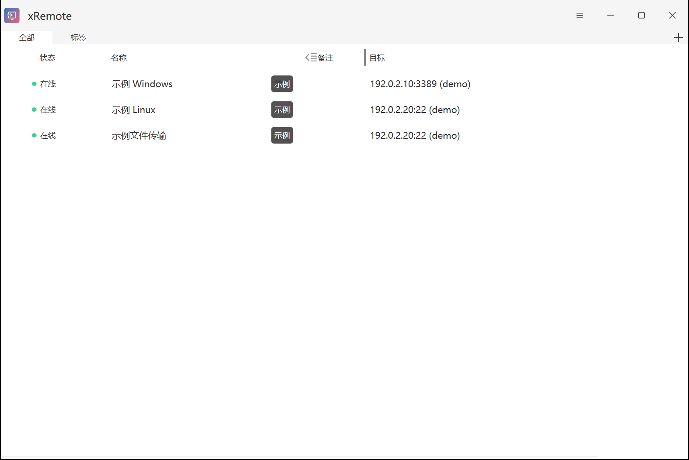

# xRemote 中文使用手册

xRemote 集中管理 Windows 远程桌面、终端和文件传输连接。本手册从安装开始，介绍连接编辑、快捷启动、外部连接程序以及数据备份。

## 阅读顺序

1. [安装与升级](installation.md)：安装版、便携版、版本检查及升级前准备。
2. [快速开始](quick-start.md)：添加第一条连接、连接设备、导入及界面设置。
3. [连接编辑](connection-editing.md)：自动保存、协议预览、RDP、RemoteApp 和 APP 配置。
4. [启动器与会话](launcher-and-sessions.md)：Alt + M、Ctrl + F、快速连接和会话操作。
5. [外部运行器与参数宏](external-runners.md)：选择连接程序、WinSCP 示例和变量替换。
6. [数据与凭据](data-and-credentials.md)：数据源、凭据复用、备份及跨电脑迁移。

## 适用版本

本手册对应 **xRemote 1.3.0 Rev.9 Windows 正式版（2026 年 10 月 16 日）**，以 1Remote 1.3.0 为基线。阅读其他发行版时，应同时查看该标签下的文档和 [版本历史](https://github.com/yuzhounh/xRemote/blob/main/CHANGELOG.md)。Android 客户端不在本手册范围内。

截图通过 Computer Use 操作独立示例实例，并按窗口原始像素导出无光标、无点击高亮的 PNG；点击图片可查看原图。`192.0.2.10`、`192.0.2.20` 和 `demo` 为演示数据；端口状态的图示不代表真实设备连接测试。截图展示浅色主题，日常使用也可选择深色主题。

## 如何打开帮助

在线手册发布在 [GitHub Pages](https://yuzhounh.github.io/xRemote/)，需要联网。下载源码后，也可以用支持 Markdown 的阅读器打开本目录，图片随文档保存在 `images/` 中。圆圈 **i** 打开应用内参数说明，不需要联网。

## 文档维护与来源

文档和截图随应用源码维护，由同一份 Markdown 自动生成 MkDocs 文档站。功能或界面变化时，同步更新对应章节、截图与帮助入口；不要只改版本号而保留不匹配的操作步骤。

本手册为 xRemote 编写，截图来自 xRemote。概念和高级功能可继续参考 [1Remote 官方文档](https://1remote.github.io/)，应用的上游来源和开源许可见 [项目说明](https://github.com/yuzhounh/xRemote) 与 [LICENSE](https://github.com/yuzhounh/xRemote/blob/main/LICENSE)。
