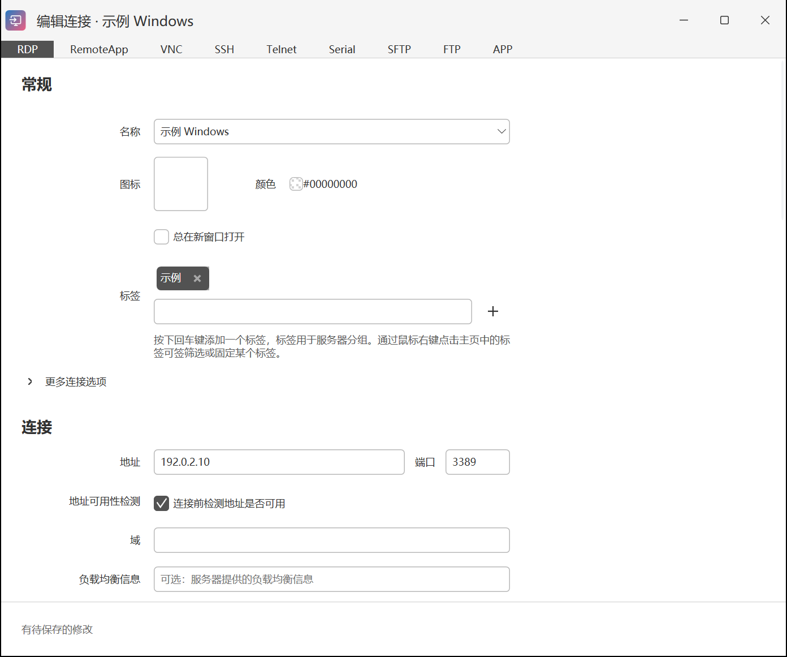
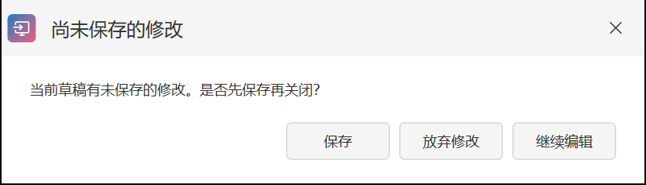
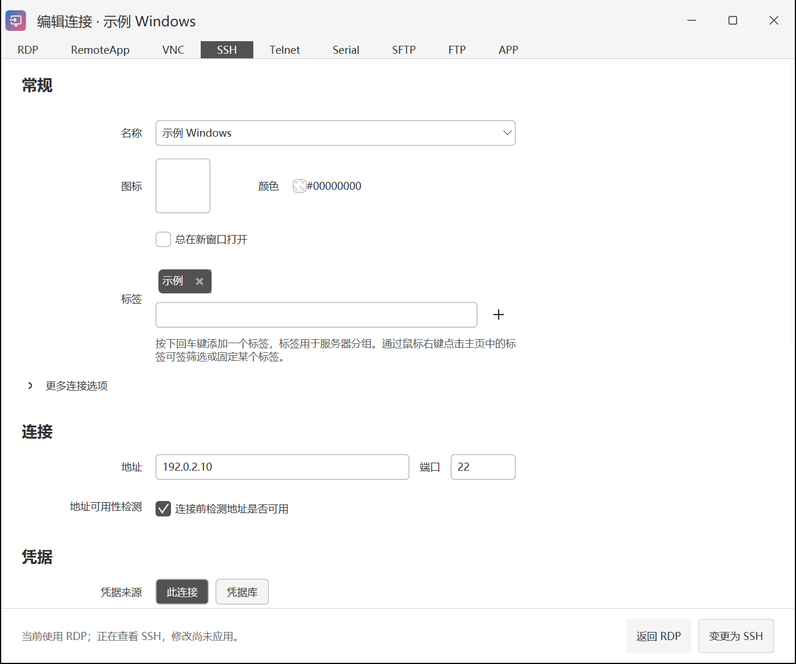
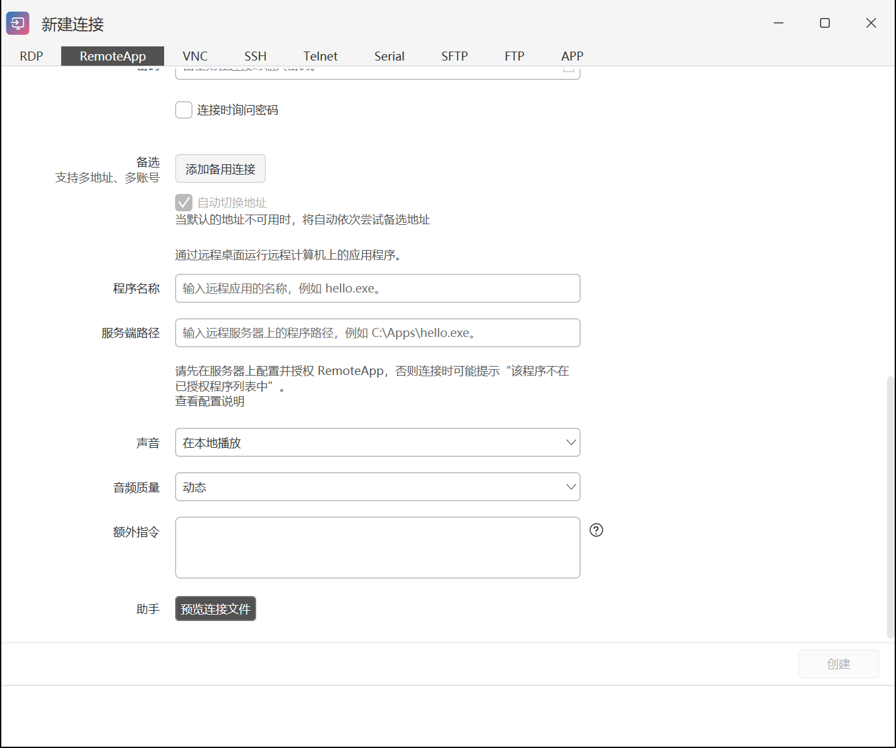
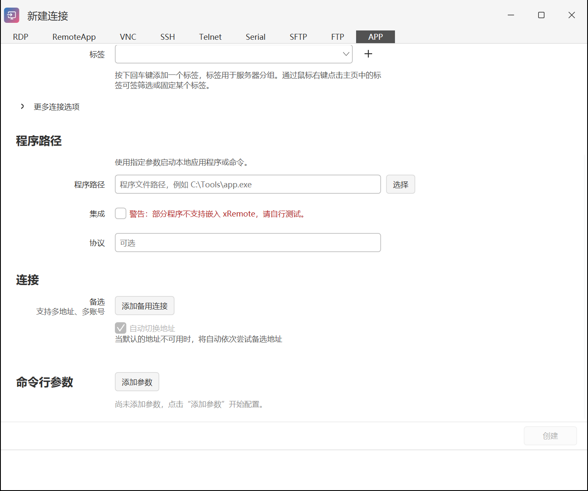

# 连接编辑

[返回手册目录](README.md) · 上一篇：[快速开始](quick-start.md) · 下一篇：[启动器与会话](launcher-and-sessions.md)

连接编辑窗口顶部选择协议，正文设置名称、标签、目标地址、凭据和协议选项。内容较长时向下滚动；“更多连接选项”可以展开。

<a id="saving"></a>
## 编辑与保存规则

- **已有单条连接**：在主窗口右键打开。有效修改会自动保存，底部显示保存状态；看到“有待保存的修改”或错误提示时，先完成必填项和校验，再确认保存完成。
- **新建连接**：填写后点击“创建”。
- **批量编辑**：核对将应用到多条连接的字段，再执行保存。
- **关闭窗口**：如果出现尚未保存的修改提示，可以选择保存、放弃修改或继续编辑。自动保存已完成的改动不会因为关闭窗口而撤销。

[](images/connection-edit.png)

[](images/connection-unsaved.png)

无效输入不会用于覆盖上一次有效保存值。若提示保存失败，保留窗口并处理错误；不要把窗口关闭或状态提示消失当成已经写入成功。

<a id="protocol-change"></a>
## 切换协议需要确认

编辑已有连接时，点击其他协议标签会先进入预览。底部显示当前协议和正在查看的协议；预览期间的改动暂不应用到原连接。

确实要转换时，点击“变更为 …”并按提示确认；只想查看字段时，点击“返回当前协议”。转换后核对端口、账号和协议专有字段。

[](images/connection-protocol-preview.png)

## 名称、标签和备用连接

名称用于列表和搜索。通过标签下拉框添加标签；标签可用于筛选，固定后便于在主窗口分组。颜色、图标和备注用于辨认设备。

支持备用连接的协议可保存多套地址和账号。启用自动切换地址时，默认地址不可用后会依次尝试备用地址。备用地址和凭据的配置应指向你实际授权访问的设备。

## RDP 显示和重定向

按需要配置分辨率、缩放、全屏、多显示器、声音、剪贴板和磁盘等选项。只有需要的本机资源才选择重定向。用户名中的域信息应与目标 Windows 登录方式一致。

<a id="mstsc-mode"></a>
## 系统远程桌面模式

RDP 表单中的 `mstsc.exe` 模式使用 Windows 系统远程桌面打开生成的 RDP 文件，会话在系统客户端中打开。它适合需要系统客户端选项的情况。

默认使用内置远程桌面控件。选择全屏并使用不同缩放比例的多个显示器时，程序也可能自动采用系统客户端，具体以该连接的显示配置为准。

<a id="additional-settings"></a>
## 额外指令

额外指令按编辑区示例**每行一条**填写。系统远程桌面模式的 RDP 文件指令采用 `名称:类型:值` 格式，例如：

```text
redirectclipboard:i:1
audiomode:i:0
```

内置控件的额外设置使用控件属性路径和类型，语法与 RDP 文件指令不同。按当前编辑区给出的示例填写，不要把两种格式直接互换。

普通额外设置可补充或覆盖相应配置，但程序管理的重连保护等选项仍按连接策略执行。可用时点击“预览连接文件”检查生成内容；不要把包含地址或账号信息的文件直接公开分享。

<a id="remoteapp"></a>
## RemoteApp

RemoteApp 在远程电脑上运行指定应用。填写远程设备的地址、端口和凭据，然后向下填写“程序名称”和“服务端路径”。服务端路径是**远程电脑上的程序路径**，不是本机路径。

[](images/connection-remoteapp.png)

目标服务器需要事先配置并授权 RemoteApp；只在 xRemote 填写路径不会完成服务器配置。出现“程序不在已授权程序列表中”等提示时，应检查服务端的发布和授权设置。声音及其他 RDP 选项按实际需求填写。

<a id="app"></a>
## 自定义 APP 连接

APP 用于带参数启动本机程序或命令。填写本机程序路径，按需添加命令行参数。参数的名称、类型、取值和引用方式以参数编辑窗口为准。

[](images/connection-app.png)

程序需要自行支持相应命令行。选择“集成”前先确认它能够嵌入 xRemote；不兼容时使用独立窗口。要为已有 SSH、SFTP、VNC 等协议统一更换连接程序，请看 [外部运行器](external-runners.md)。
