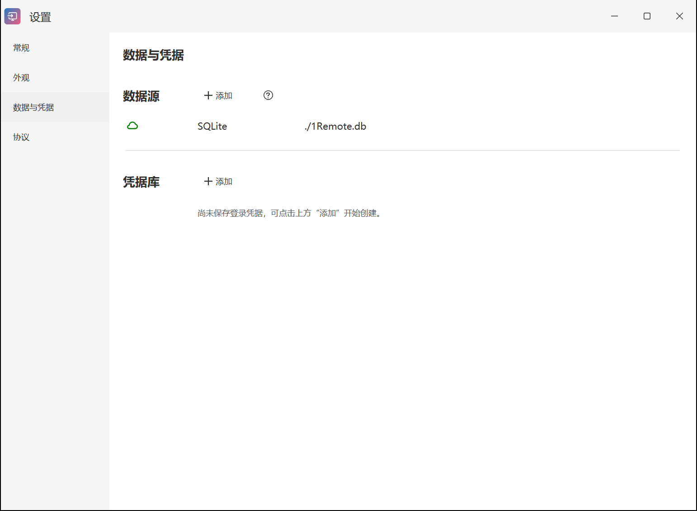
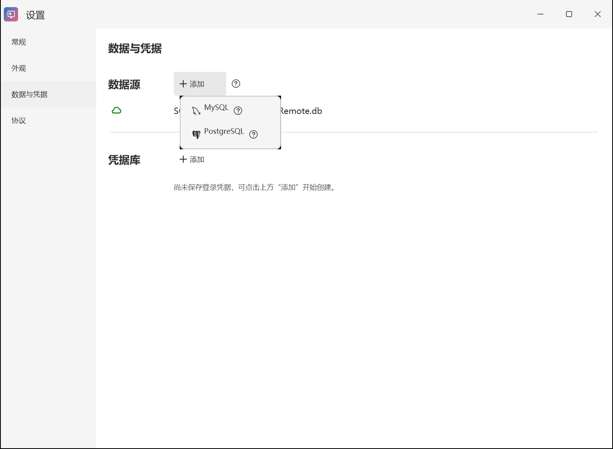

# 数据与凭据

[返回手册目录](README.md) · 上一篇：[外部运行器](external-runners.md)

“设置 → 数据与凭据”集中管理连接数据库和可复用账号信息。连接数据、本机界面状态和本机记住的 RDP 密码分别存储，备份与迁移时需要一起考虑。

## 数据位置

全新安装版的主要配置位于 `%APPDATA%\1Remote`，本机状态位于 `%LOCALAPPDATA%\1Remote`。便携模式的两类文件都在程序目录。沿用的 `1Remote` 文件名是兼容设计，无需手动改名。

主要配置包括：

- `1Remote.json`：常规、外观、启动器及本地数据库位置等设置。
- `1Remote.db`：默认 SQLite 数据库，保存连接及凭据库记录。若修改过路径，以数据源页面显示的实际文件为准。
- `1Remote.dataSources.json`：附加数据库配置。
- `Protocols/`：外部连接程序的路径、参数及配置。

本机状态包括 `.locality/` 中的界面和连接使用记录、`.icons/` 中的自定义图标，以及本机终端程序使用的 `KiTTY/`、`PuTTY/` 等目录。记住的 RDP 密码位于 `.locality/.rdp-passwords.json`。

安装版的数据可能分布在两个 AppData 目录中，不能只复制安装目录当作完整备份。自定义私钥、外部程序和其他文件引用也要单独保管。

## 凭据库和连接凭据

在凭据库标题旁点击“添加”，为一组账号信息命名。编辑支持凭据来源选择的连接时，可在“此连接”和“凭据库”之间选择。

“此连接”保存该条连接自己的信息；引用凭据库便于多条连接复用同一账号。修改共享凭据前，确认哪些连接正在引用它，避免把只针对一台设备的账号变化应用到其他设备。

## 本机记住的 RDP 密码

xRemote 的本机 RDP 密码缓存使用 Windows 当前用户的数据保护机制（DPAPI），并与连接标识、地址、端口和用户名匹配。匹配信息改变、缓存缺失或无法解密时，需要重新输入密码。

这种缓存与数据库中的连接记录、凭据库不是同一个存储层。复制数据库可以恢复连接列表，却不保证恢复本机缓存密码；复制缓存文件到另一台电脑或另一个 Windows 账户也不能保证解密。

“查看密码前验证 Windows 身份”控制敏感操作前的身份核验，不应被理解为整个数据库或所有导出文件都具有同样的 Windows 用户绑定保护。

## 在线数据库

点击数据源标题旁的“添加”，可配置 MySQL 或 PostgreSQL。它们需要自行准备可访问的数据库、账号和权限；添加菜单不会代为创建远程数据库服务。

填写数据库地址、端口、库名和认证信息后，使用配置窗口的连接检查确认可用，再保存。不要把远程数据库密码当作目标 RDP 或 SSH 的登录密码；二者用途不同。

数据库服务端配置的详细示例暂可参考 [1Remote 在线数据库文档](https://1remote.github.io/usage/database/use-online-database/)，xRemote 的菜单位置以本文为准。

## 团队共享

共享数据库可以让多台客户端读取同一组连接，但编辑能力取决于实际数据库账号权限和数据源的可写状态。只读数据源中的连接不能按本地可写连接的方式修改。

团队部署应分别安排数据库维护者和使用者权限；不要将“界面不显示密码”等同于接收者无法获得凭据。需要进一步配置时参考 [上游团队共享说明](https://1remote.github.io/usage/team/team-sharing/)。

不要将正在写入的 SQLite 文件放在多个客户端中同时编辑，再依赖网盘合并冲突。有多人并行维护需求时，应规划在线数据库和明确的写入权限。

## 备份步骤

1. 完成编辑并确认保存，从托盘菜单退出程序。
2. 复制主要配置目录和本机状态目录；便携版可以复制完整便携目录。若数据库放在自定义位置，一起复制实际数据库文件。
3. 保存自定义私钥等被引用文件，并记录它们原来的路径。远程 MySQL/PostgreSQL 的内容需通过数据库自身的备份方式另行保存。
4. 将备份保存在受控位置。连接导出和配置备份都可能包含地址、账号或凭据信息，不应提交到公开源码仓库。

## 导出连接

导出适合转移选定连接；完整备份还包括设置、运行器、自定义图标和本机状态。不要把导出连接视为所有文件、全部密码和远程数据库内容的完整备份。

## 跨电脑迁移

先在目标电脑安装程序并退出，再按需要恢复配置或导入连接。核对本地数据库路径、外部连接程序路径及私钥路径；更换目录或盘符后，旧的绝对路径可能需要修改。

本机 RDP 密码缓存及其他由 Windows 用户保护的信息，按需在目标电脑重新输入。恢复后先确认连接列表、账号和目标，再分别验证常用协议；原电脑的备份应保留到迁移确认完成。
