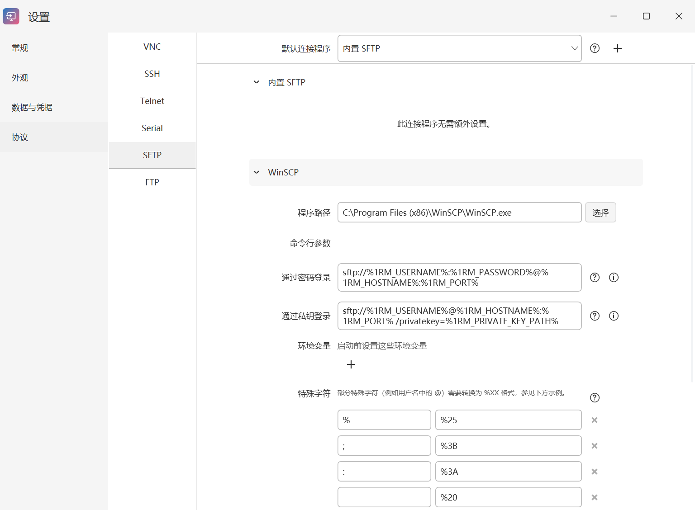
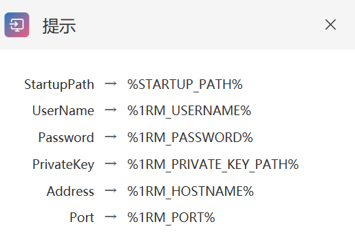

# 外部运行器与参数宏

[返回手册目录](README.md) · 上一篇：[启动器与会话](launcher-and-sessions.md) · 下一篇：[数据与凭据](data-and-credentials.md)

运行器是实际打开会话的连接程序。xRemote 提供内置连接方式，也可以调用本机的 PuTTY、KiTTY、WinSCP 或 VNC 客户端。设置中的“默认连接程序”决定该协议默认使用哪一种。

<a id="configuration"></a>
## 查看和选择连接程序

1. 打开“设置 → 协议”。
2. 在左侧选择 VNC、SSH、Telnet、Serial、SFTP 或 FTP。
3. 展开所需程序，检查路径和参数。内置程序没有额外配置时，页面会直接提示。
4. 确认外部程序已在当前电脑安装，再在顶部选择默认连接程序。

RDP 的系统客户端选项在连接编辑窗口中，见 [系统远程桌面模式](connection-editing.md#mstsc-mode)。只想创建一个独立程序入口时，可以使用 [APP 连接](connection-editing.md#app)。

## WinSCP 配置示例

在 SFTP 设置中展开 WinSCP：

1. 点击“选择”，指定本机实际存在的 `WinSCP.exe`。示例默认路径不代表已自动安装。
2. 核对“通过密码登录”和“通过私钥登录”各自的参数。
3. 如需默认使用 WinSCP，在顶部的“默认连接程序”选择它。
4. 返回连接列表，用一条你有权限访问的 SFTP 连接检查效果。

[](images/runner-winscp.png)

程序内置的密码方式参数示例为：

```text
sftp://%1RM_USERNAME%:%1RM_PASSWORD%@%1RM_HOSTNAME%:%1RM_PORT%
```

私钥方式使用单独的参数模板：

```text
sftp://%1RM_USERNAME%@%1RM_HOSTNAME%:%1RM_PORT% /privatekey=%1RM_PRIVATE_KEY_PATH%
```

参数需要符合所用 WinSCP 版本的语法。路径含空格时，按外部程序的规则加引号；检查生成参数时，不要将真实密码或私钥内容贴到公开问题报告中。

<a id="macros"></a>
## 参数宏

点击参数输入区右侧的圆圈 **i**，查看该协议当前可用变量。点击右上角 **×** 或按 **Esc** 关闭说明窗口。圆圈 **？** 打开本文的配置说明。

[](images/runner-macros.png)

常见变量包括：

- `%1RM_HOSTNAME%`：连接地址。
- `%1RM_PORT%`：端口。
- `%1RM_USERNAME%`：用户名。
- `%1RM_PASSWORD%`：密码。
- `%1RM_PRIVATE_KEY_PATH%`：供外部程序使用的私钥文件路径。
- `%STARTUP_PATH%`：应用启动路径。

不同协议可用变量不同，以 **i** 弹窗为准。变量保留 `1RM` 前缀用于兼容已有配置；不要把它们改成 `%XREMOTE_...%`，也不要照搬旧教程里的 `%HOSTNAME%` 等旧名称。

## 添加自定义程序

点击“默认连接程序”右侧的 **＋**，输入不重复的程序名称，再配置程序路径、命令行和所需环境变量。参数支持哪些值，取决于所选协议和该外部程序自身的命令行接口。

除非明确需要改变整个协议的默认程序，可以先保留原默认值，完成配置后再切换。该程序的配置保存在 [数据目录中的 `Protocols/`](data-and-credentials.md#storage)。

<a id="special-characters"></a>
## 环境变量、特殊字符和集成

**环境变量**在启动外部程序前设置。它们与命令行参数是两种不同传参方式，应按外部程序要求填写。

**特殊字符**用于替换参数值中的特定字符。例如 WinSCP 的会话 URL 中，用户名包含 `@` 时通常需要转换为 `%40`。内置 WinSCP 配置已有常用替换规则，保留有效规则，避免重复编码。

**集成**尝试将外部程序嵌入 xRemote。兼容性取决于该程序；窗口异常或无法操作时，先关闭集成并使用独立窗口。

## 配置后仍无法连接

先确认程序路径有效；再核对协议、端口、认证方式及宏名称。若外部程序本身也无法连接，应先解决该程序的网络或认证问题。设置默认程序不会自动安装软件、配置服务器或生成登录权限。
