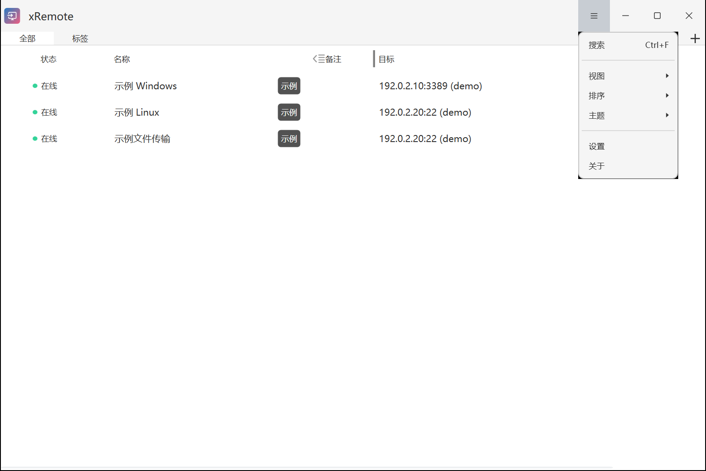
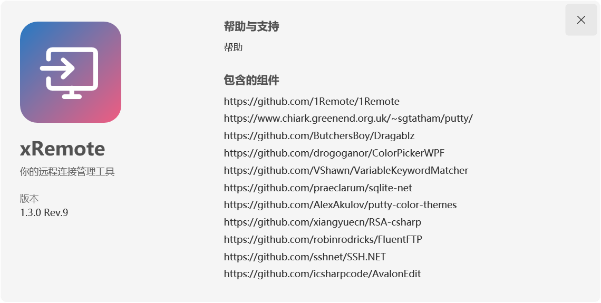

# 安装与升级

[返回手册目录](README.md) · 下一篇：[快速开始](quick-start.md)

xRemote 提供 Windows x64 自包含安装版和便携版。正式下载入口为 [xRemote 最新发布页](https://github.com/yuzhounh/xRemote/releases/latest)，请选择该页面的安装包，而不是上游 1Remote 的商店或包管理器版本。

## 安装版

1. 下载发布页中的 x64 安装程序 `.exe`。
2. 退出已有 xRemote 实例后运行安装程序，选择安装目录及所需快捷方式。
3. 安装完成后启动 `xRemote.exe`。

全新安装默认将主要配置和数据库放在 `%APPDATA%\1Remote`，本机状态放在 `%LOCALAPPDATA%\1Remote`。这些目录沿用 1Remote 名称，以兼容已有数据。详细文件清单见 [数据位置](data-and-credentials.md#storage)。

安装到已有便携目录时，安装程序会保留该目录的便携模式选择，不会自动将已有配置迁到 AppData。卸载程序保留用户自行生成的配置，但卸载前仍应先备份。

## 便携版

1. 下载发布页中的 Windows x64 `.zip`。
2. 解压到有写入权限的独立目录，再运行其中的 `xRemote.exe`。不要直接在压缩包内运行。
3. 保留包内的 `FORCE_INTO_PORTABLE_MODE` 标记。便携模式将配置、数据库和本机状态保存在程序目录。

便携模式便于管理程序和数据的位置；其中由 Windows 当前用户保护的密码仍有其迁移限制，见 [跨电脑迁移](data-and-credentials.md#migration)。

## 查看版本和更新

打开主窗口右上角菜单，选择“关于”，查看版本号。`1.3.0 Rev.14` 中的 `1.3.0` 是上游基线，`Rev.14` 是 xRemote 自己的发行修订号。“新版本”与版本号分两行显示，点击第二行版本号可查看发布说明。

点击“关于”卡片右上角的 **×**，或按 **Esc** 关闭卡片。

“设置 → 常规”中的“自动下载更新，退出后安装”控制自动更新。发现正式新版后，应用在后台下载完整更新包，验证签名与文件校验值，准备完成后在“关于”显示“更新已就绪，下次启动自动生效”，并提供“重启并更新”入口。

应用运行期间不替换程序文件。真正退出后，独立助手静默更新程序，不弹出安装窗口，也不自动重新打开软件；下次正常启动即使用新版。关闭主窗口若只是收进托盘，则仍在运行，不触发安装。只有你主动点击“重启并更新”，才会走正常保存、退出和重新启动流程，现有本地远程会话会随退出断开。

若关机或安装中断，下次启动会先恢复或完成更新，再打开主界面。下载、签名或安装失败时保留或恢复旧版，更新状态只在应用内显示并稍后重试。配置、连接数据库、密码、自定义协议与原存储模式保持不变。无法写入受保护目录时不自动提权。

首次从不含更新器的旧版升级，需要手动安装一次包含更新器的版本；此后的正式发布必须同时提供完整包与签名更新清单，客户端不会自动安装缺少可信清单的发行包。

## 升级已有安装

1. 确认连接编辑窗口没有尚未保存的修改，等待保存完成。
2. 从托盘菜单退出 xRemote。主窗口的关闭按钮可能只会最小化到托盘。
3. 按 [备份步骤](data-and-credentials.md#backup) 保存当前配置、数据库及本机状态。
4. 安装版使用新版安装程序；便携版用新版程序文件更新原便携目录，保留原有数据和模式标记。避免把新包作为一个空白目录启动后误认为原数据丢失。
5. 启动后核对版本、连接列表和自定义连接程序路径。跨电脑或 Windows 账户迁移时，按需重新输入本机记住的密码。

不要在程序仍运行时覆盖 DLL 或复制正在写入的数据库。自定义数据库位置以实际设置为准，不一定在默认目录。

## 首次启动检查

- 若界面不是中文，在“设置 → 常规 → 语言”选择简体中文。
- 若显示空列表，先确认启动的是原安装位置、存储模式和 Windows 账户，再检查数据源路径。
- 若快捷键没有响应，在“设置 → 常规”检查启动器是否启用，以及快捷键是否被其他程序占用。

继续阅读：[添加第一条连接](quick-start.md#first-connection)。
