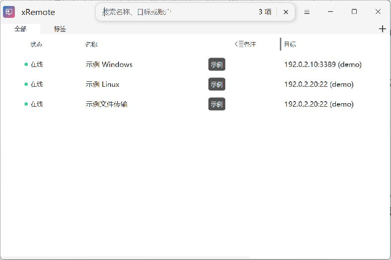
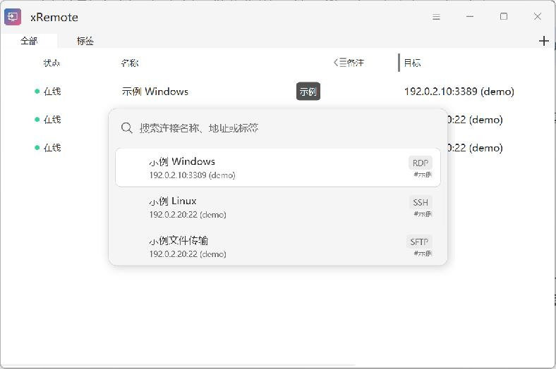
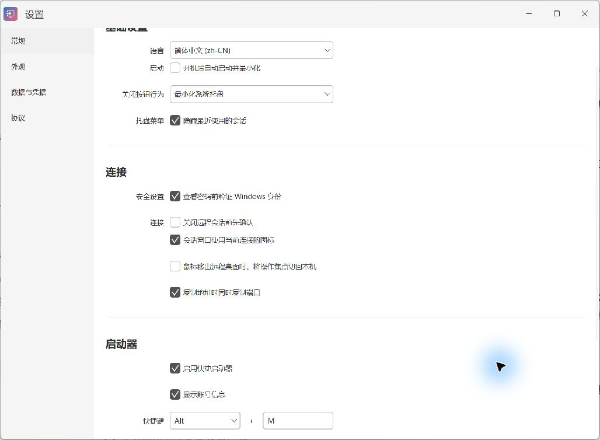

# 启动器与会话

[返回手册目录](README.md) · 上一篇：[连接编辑](connection-editing.md) · 下一篇：[外部运行器](external-runners.md)

xRemote 提供主窗口搜索和全局快捷启动器。前者用于筛选当前列表，后者用于快速找到并启动连接。

## 主窗口搜索

在主窗口按 `Ctrl + F` 打开搜索栏，输入名称、目标地址或账号。右侧显示筛选后的数量；点击搜索栏的关闭按钮或按 `Esc` 退出搜索。

标签也可以筛选连接。列表列宽可拖动调整并保存；主窗口菜单中的“视图”用于切换列表、卡片等显示方式。

## Alt + M 快捷启动器

应用运行时，默认按 `Alt + M` 打开启动器。输入关键词，用上下方向键选择结果，按 `Enter` 发起连接，按 `Esc` 关闭启动器。

启动器显示名称、目标及协议，启用相关选项时也显示账号。名称相近时，先核对目标和账号再连接。

在“设置 → 常规 → 启动器”可启用启动器、修改快捷键和控制账号信息显示。如果默认快捷键与其他程序冲突，改用没有占用的组合。

## 快速连接

在启动器搜索界面按 `Tab` 切换到快速连接，选择协议并填写目标信息。它适合临时连接；经常使用的目标可另建为保存的连接。

“允许快速连接记住输入的地址”控制地址输入记录，不等于记住目标登录密码。账号和密码仍按连接及认证方式处理。

## 会话标签和窗口

使用内置或支持集成的连接程序时，会话可在 xRemote 的标签窗口中显示。点击标签切换会话，通过标签上的关闭按钮结束对应会话。设置了“总在新窗口打开”的连接，按该选项创建独立窗口。

使用系统 `mstsc.exe` 模式或不集成的外部程序时，远程会话在对应程序的窗口中显示。外部程序的标签、快捷键及关闭行为遵循该程序自身的规则。

“设置 → 常规”可配置关闭远程会话前确认、会话图标等选项。断开连接、关闭客户端和在远程系统中注销并不相同；需要结束远程登录时，应在目标系统中执行注销。

## 托盘与退出

主窗口关闭按钮的行为由常规设置决定，可能只是最小化到托盘，远程会话也可能继续运行。要升级程序或结束所有本地进程时，从托盘菜单选择退出，并处理未保存修改和会话确认。

托盘可以显示最近使用的连接；“隐藏最近使用的会话”控制该列表是否显示。

## 连接状态与远程使用情况

主窗口的“在线”首先表示目标 TCP 端口可达。它不证明密码正确，也不说明目标没有其他用户会话。

涉及远程会话查询、配对管理服务等功能时，需要对应设备另外配置；不要把端口状态当成管理服务已经安装或配对成功。基础 RDP、SSH 等连接无需为了查看端口状态而安装管理服务。
