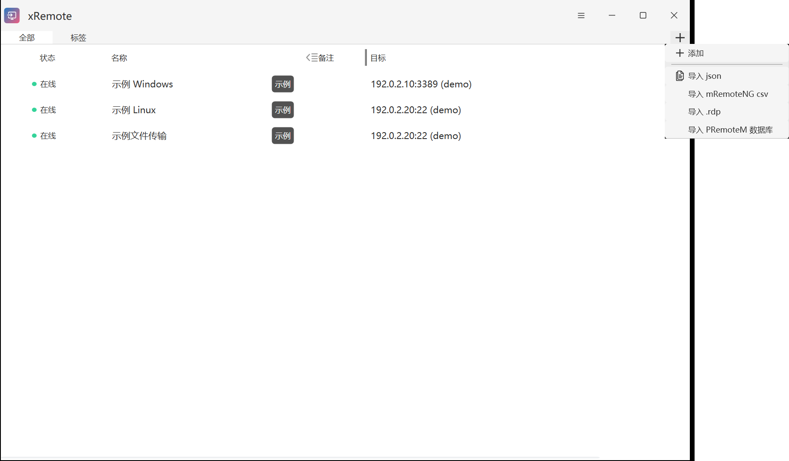
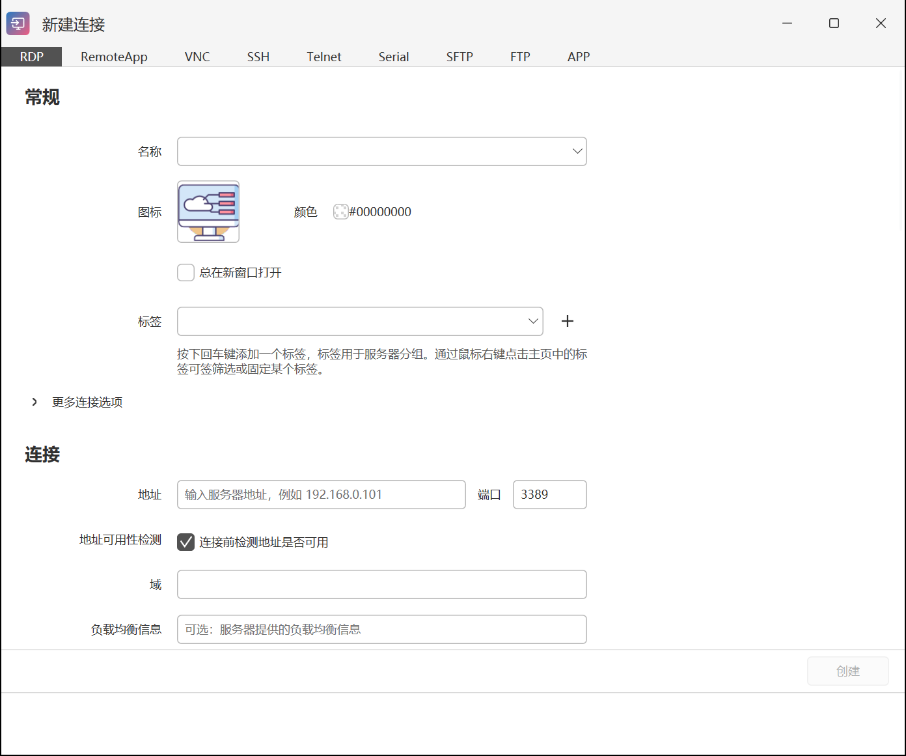
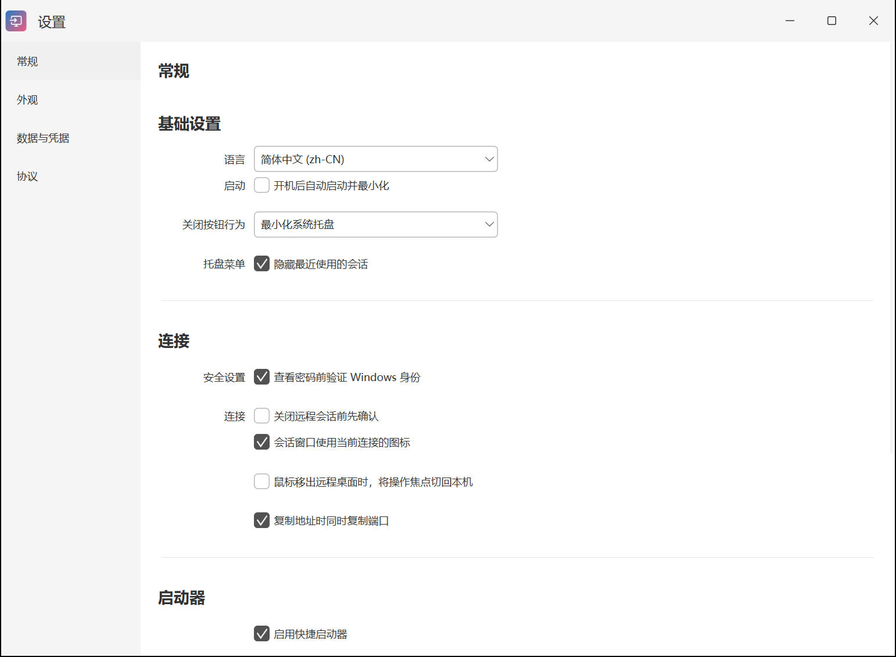
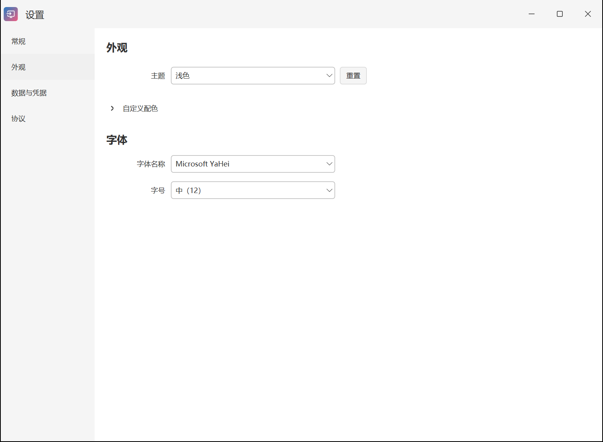

# 快速开始

[返回手册目录](README.md) · 上一篇：[安装与升级](installation.md) · 下一篇：[连接编辑](connection-editing.md)

准备一台已启用对应远程服务的设备，以及可用的地址、端口和账号。xRemote 管理并发起连接；目标设备的 RDP、SSH 或文件服务需要事先配置好。

## 添加第一条连接

1. 点击主窗口右上角的 **＋**，选择“添加”。
2. 在窗口顶部选择协议，例如 Windows 远程桌面选择 RDP，Linux 终端选择 SSH。
3. 填写名称、地址和端口，再向下查看凭据及协议选项。示例名称可用“办公电脑”，示例地址 `192.0.2.10` 只用于说明，应替换为你自己的设备地址。
4. 填写所需账号信息；需要在连接时输入密码的，可使用对应密码提示选项。
5. 点击底部“创建”。新建连接需要显式创建，不能只关闭窗口。

默认端口通常为 RDP `3389`、SSH/SFTP `22`、VNC `5900`、FTP `21`、Telnet `23`。目标服务改过端口时，以实际配置为准。

## 发起连接

在主窗口双击连接，或按 `Alt + M` 打开启动器，搜索名称后按 `Enter`。部分连接会要求输入密码或进行目标服务认证，按提示完成。

“在线”表示检测时目标端口可达，不表示账号认证成功，也不能判断远程是否已有其他人在使用。端口检测和真实连接使用相同的目标地址，但网络代理、服务状态等可能影响结果。

## 修改已有连接

在列表中右键点击连接，打开编辑窗口。已有连接的有效修改会自动保存，底部显示保存状态。新建、批量编辑和更改协议有各自的确认规则，见 [连接编辑](connection-editing.md)。

## 导入已有连接

点击右上角 **＋**，按已有文件类型选择导入：JSON、mRemoteNG CSV、RDP 文件或 PRemoteM 数据库。先备份当前数据，再选择来源明确的文件。

导入连接信息不保证第三方软件保存的密码能直接复用。导入后先核对协议、地址、端口和账号，再连接；私钥及外部程序路径也需要在当前电脑存在。

## 设置语言和主题

从主窗口右上角菜单打开“设置”：

- **常规**：语言、关闭按钮行为、启动器及其他日常选项。
- **外观**：主题、字体和字号；需要时展开自定义配色。
- **数据与凭据**：管理连接数据库和可复用凭据。
- **协议**：选择各类连接使用的内置或外部程序。

## 连接失败时先检查什么

先检查地址和端口是否正确、目标服务是否启用、当前网络或 VPN 是否能到达设备。端口可达但登录失败时，再检查账号格式、密码、私钥及目标端的权限。使用外部程序时，还要检查该程序是否已安装和路径是否有效。

继续阅读：[编辑与保存规则](connection-editing.md#saving) 或 [快捷搜索](launcher-and-sessions.md)。
