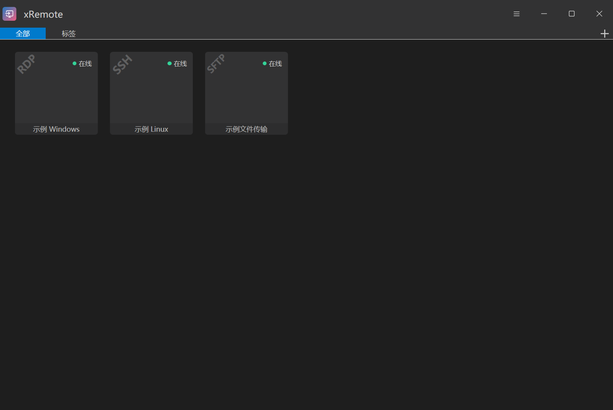

<p align="center">
  
</p>

<h1 align="center">xRemote</h1>

<p align="center"><strong>集中管理远程连接，用简洁的标签页与快捷启动器连接每一台设备。</strong></p>

<p align="center">
  <a href="https://github.com/yuzhounh/xRemote/releases/latest"></a>
  <a href="LICENSE"></a>
  
  
</p>

<p align="center">
  <a href="https://github.com/yuzhounh/xRemote/releases/latest">下载发布版</a> · <a href="#快速开始">快速开始</a> · <a href="https://yuzhounh.github.io/xRemote/">中文使用手册</a> · <a href="CHANGELOG.md">版本历史</a> · <a href="LICENSE">开源协议</a>
</p>

xRemote 是基于 [1Remote](https://github.com/1Remote/1Remote) 定制的 Windows 远程会话管理器，集中管理远程桌面、终端与文件传输连接，提供标签页、快捷搜索与多种主题。当前发布版本为 **xRemote 1.3.0 Rev.12**，支持后台下载完整更新包、真正退出后静默升级，下次启动使用新版。

<p align="center">
  <strong>浅色主题 · 列表视图</strong><br>
  
</p>

<p align="center">
  <strong>深色主题 · 卡片视图</strong><br>
  
</p>

## 相对 1Remote 的主要改进

- **会话操作**：重做 Chrome 风格圆角标签栏，增加当前标签与最近成功连接菜单，主窗口和会话窗口使用原生 Windows 标题栏按钮。
- **连接管理**：增加独立的在线与远程使用状态、设备详情、Ctrl+F 搜索条、可保存的列顺序、显隐与列宽，以及应用内 DPAPI 加密的 RDP 密码保存与复用。
- **界面整理**：统一品牌标志、浅灰/深色主题、圆角菜单和中文设置，重新设计启动器并整理协议设置布局。
- **发行维护**：采用独立 Rev. 修订号、自有 GitHub 更新源，以及自包含便携版和安装版。

在 [Release list](https://github.com/yuzhounh/xRemote/releases) 可逐版查看 Rev.1–Rev.12 的改动；[版本变更与开发历史](CHANGELOG.md) 提供汇总。Rev.1–Rev.6 为历史日志补录，关联的归档只含文档；各版独立应用源码标签和正式安装包从 Rev.7 开始提供，首次公开的 Rev.7 源码已包含此前成果。

## 功能特点

- **多协议连接**：支持 RDP、SSH、VNC、Telnet、FTP、SFTP、RemoteApp，以及自定义外部程序。
- **标签页会话**：在同一窗口管理多个远程会话，通过标签切换设备；RDP 支持多显示器与 HiDPI。
- **快捷启动器**：按 `Alt + M` 搜索并启动连接，支持键盘操作。
- **连接管理**：使用分类、标签、图标、颜色与备注整理设备，配置连接脚本，并导入 mRemoteNG 连接。
- **外观与交互**：提供浅色、深色等主题和多语言界面，支持自定义协议运行器。
- **自有更新源**：默认检查本仓库的正式发布版本，在后台下载并校验完整包，真正退出后静默安装，下次启动使用新版。
- **两种安装方式**：提供 Windows x64 自包含便携包与安装程序，按使用习惯选择。

## 快速开始

1. 打开 [最新发布页](https://github.com/yuzhounh/xRemote/releases/latest)，下载 Windows x64 安装版（`.exe`）或便携版（`.zip`）。
2. 安装后启动 xRemote，或解压便携包后运行 `xRemote.exe`。
3. 新建连接，选择协议并填写设备地址、账号等信息；保存后即可连接，也可通过 `Alt + M` 搜索启动。

安装版默认使用 Windows AppData 保存配置；便携版将配置保存在程序目录。升级前退出旧版并保留已有配置、数据库和凭据文件。安装版卸载时保留用户配置。

完整图文教程见 [中文使用手册](https://yuzhounh.github.io/xRemote/)，包括安装升级、快速开始、连接编辑、启动器与会话、外部运行器以及数据与凭据。[文档源码](docs/README.md)与项目一同维护。

## 从源码构建

安装 .NET 9 SDK，在 Windows 下初始化子模块并应用项目维护的依赖补丁：

```powershell
git submodule update --init --recursive
.\scripts\Prepare-Dependencies.ps1
dotnet publish Ui/Ui.csproj -c Release -r win-x64 --self-contained true -o artifacts/publish
.\scripts\Package-WindowsRelease.ps1 -PublishDirectory artifacts/publish
.\scripts\Build-WindowsInstaller.ps1 -PackageDirectory artifacts/package-1.3.0-r12
```

生成安装程序还需要 Inno Setup 6；发布时构建无运行库依赖的启动器需要 Visual C++ Build Tools。发行入口为原生 `xRemote.exe`，负责在加载 .NET 前处理未完成更新；主程序宿主 `1Remote.exe` 打包时重命名为 `xRemote.App.exe`，仍使用内部 `1Remote.dll`。发行包只包含程序文件和便携模式标记，不包含本地连接配置、数据库或凭据。

Release 发布同时包含 `xRemote-update-win-x64.json` 签名清单与完整 ZIP；打包脚本使用本地忽略目录 `update-signing-private/release-key.xml` 的私钥，客户端只内置 `Updater/update-public-key.xml` 公钥。私钥不能提交或上传，也不能在普通重建时重新生成。缺少私钥的构建机仍可编译，但必须取得既有签名能力后才能生成供自动更新使用的发行包。更新下载在后台完成，真正退出后静默应用，下次启动生效；详见[安装与升级](docs/installation.md)。

## 版本规则

- `Ui/AppVersion.cs` 分别定义官方基线和 xRemote 修订号；当前界面版本为 `1.3.0 Rev.12`，Windows 数字版本为 `1.3.0.12`。
- 官方基线只在整合对应上游版本时更新；`ForkRevision` 只在正式发布 xRemote 时递增，整合上游新版后也不归零，普通编辑和重复编译不递增。
- Git 标签使用 `v1.3.0-r12`，便携包使用 `xRemote-v1.3.0-r12-x64.zip`。
- 为兼容已有数据，内部程序集、配置文件名及凭据存储标识继续沿用 1Remote。

## 开源协议与致谢

本项目基于 [1Remote](https://github.com/1Remote/1Remote) 开发，采用 [GNU GPL v3](LICENSE) 许可。感谢原作者与贡献者提供的远程会话管理基础。
